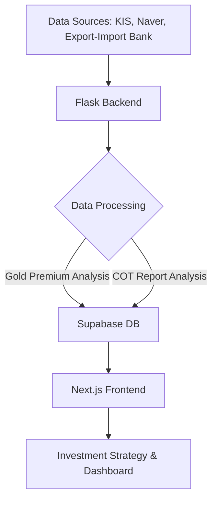

# Financial Dashboard

> **실시간 금 프리미엄 분석 및 선물 시장 투자 전략 플랫폼**
> 본 프로젝트는 국내외 금 시세 데이터와 COMEX 선물 계약 정보를 실시간으로 분석하여 투자 신호를 제공하는 풀스택 대시보드 솔루션입니다.

---

## 서비스 흐름도



---

## 주요 기능

* **실시간 금 프리미엄 분석**: 국제 금시세(USD/oz)와 국내 시세를 실시간 환율을 적용하여 비교 분석하고 프리미엄 등급을 자동 판정합니다.
* **투자 전략 신호 생성**: 분석된 프리미엄과 시장 심리 지표를 기반으로 매수/매도 신호 및 전략 강도를 산출합니다.
* **선물 계약 및 COT 분석**: COMEX 금 선물 활성 계약 추적 및 CFTC COT 보고서 분석을 통해 상업적/투기적 포지션 변화를 모니터링합니다.
* **자동화된 데이터 파이프라인**: 5분 간격 백그라운드 갱신 및 캐시 시스템을 통해 API 호출을 최적화하고 최신 시장 지표를 유지합니다.

---

## 트러블슈팅 및 인사이트

### 1. 데이터 정합성 확보: 다중 금융 API 통합 및 최적화

* **문제**: 한국투자증권, 네이버 금융, 수출입은행 등 각기 다른 데이터 소스의 업데이트 주기와 데이터 포맷 차이로 인한 정합성 문제 발생.
* **해결**: 중앙 집중형 API 유틸리티(`api_utils.py`)와 캐시 시스템을 구축하고, 백그라운드 스케줄러를 통해 5분 간격으로 데이터를 동기화하여 실시간 분석의 정확도를 높임.
* **결과**: 다중 API 호출 최적화로 응답 속도를 개선했으며, 수동 확인 없이도 정밀한 금 프리미엄 분석 결과를 사용자에게 제공.

### 2. 도메인 지식의 기술적 구현: 투자 심리 지표 계량화

* **문제**: 단순 시세 나열을 넘어 실제 투자에 유용한 '액셔너블(Actionable)'한 정보를 제공해야 하는 과제.
* **해결**: 선물 시장의 COT(Commitments of Traders) 보고서 데이터를 파이썬(`cot-reports`)으로 분석하여 시장 참여자들의 포지션 변화를 지표화하고, 이를 프리미엄 분석과 결합하여 투자 신호 생성 로직을 직접 설계함.
* **결과**: 금융 도메인 지식을 알고리즘화하여 데이터 시각화 이상의 가치를 제공하는 전문적인 투자 분석 플랫폼 구현.

---

## 기술 스택

* **Frontend**: Next.js 15.5.0, React 19.1.0, TypeScript, Tailwind CSS 4, next-themes
* **Backend**: Python 3.8+, Flask, Supabase, Pandas, NumPy, cot-reports, Gunicorn
* **Deployment**: Vercel (Frontend), Render (Backend)

---

## 프로젝트 구조

```bash
financial_dashboard/
├── backend/                    # Flask API 서버 (분석 및 DB 연동)
│   ├── gold_data.py           # 금 프리미엄 분석 엔진
│   ├── analysis.py            # COT 보고서 고급 분석
│   └── database.py            # Supabase 연동 모듈
└── frontend/                   # Next.js 프론트엔드 (App Router)
    ├── components/            # 투자 전략 및 분석 UI 컴포넌트
    └── app/                   # Next.js 15 App Router 페이지 구성

```
